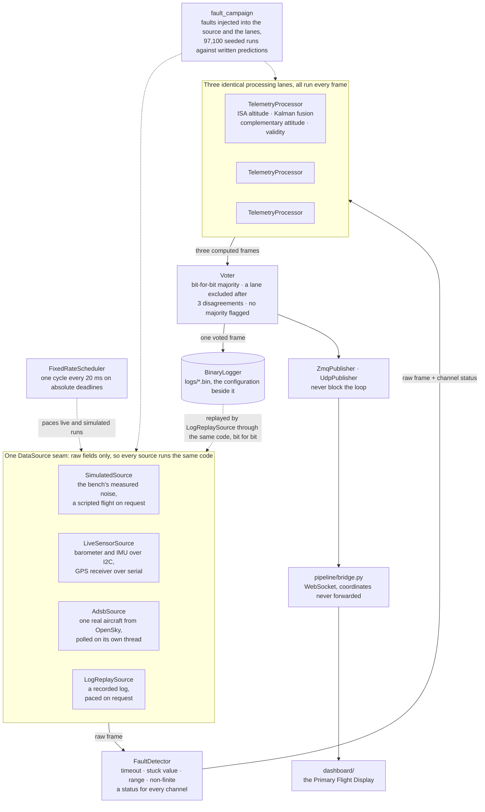

# Flight Telemetry System

[](https://github.com/DerekZ-113/flight_telemetry/actions/workflows/ci.yml)

Embedded flight telemetry for a Raspberry Pi in C++17: barometer, IMU and GPS fused into altitude and attitude at 50 Hz, with per-channel fault detection. Three ideas run through it. A deterministic core: a binary log replays bit for bit through the same pipeline. Requirements traceability: every line of code traces to a written requirement and a test. Redundancy with voting: three identical processing lanes behind one detector, a majority voter choosing the output. DO-178C-aligned practices, not certification.

**Status.** Built and verified on simulated and replayed data and, since 2026-10-20, on the Raspberry Pi: the barometer, IMU and GPS drivers, the pipeline with Kalman constants measured on a stationary capture, the detector, the three lanes and the voter, logging and replay, both transports, the bridge and the PFD, the ADS-B source, and the fault-injection campaign of record. Five requirements remain partial, each with what it lacks in [the matrix](docs/traceability_matrix.md). Results: [verification_results.md](docs/verification_results.md).

## Architecture



- **Data source seam** ([§3](docs/design.md#3-datasource-abstraction)): one `read_frame()`, raw fields only; live, simulated and replayed frames run the same code.
- **Drivers** ([§3](docs/design.md#3-datasource-abstraction)): a BMP280-compatible barometer (a BME280 on the bench) and the MPU6050 behind an I2C seam, the GPS behind a serial seam, verified on fakes and on the Pi.
- **ADS-B source** ([§3](docs/design.md#3-datasource-abstraction)): one real aircraft from the OpenSky Network as the GPS channel, selected with hysteresis.
- **Configuration** ([§3](docs/design.md#3-datasource-abstraction)): one YAML file, validated at startup, injected by constructor, recorded beside each log.
- **Detector before processor** ([§4](docs/design.md#4-processing-pipeline-order)): faults judged on the frame's own timestamp, so replay reproduces them.
- **Altitude fusion** ([§5](docs/design.md#5-kalman-filter-design)): a two-state Kalman filter over barometer and GPS, updated only on fresh readings.
- **Attitude** ([§6](docs/design.md#6-complementary-filter-design)): a complementary filter for pitch and roll, re-seeded after a long gap.
- **Health and validity** ([§7](docs/design.md#7-health-and-validity)): a status per channel, a validity byte per computed field, in the frame.
- **Determinism** ([§8](docs/design.md#8-determinism)): same-platform replay is bit-exact; cross-platform identity is not claimed.
- **Log, wire and replay** ([§9](docs/design.md#9-log-format-and-replay)): raw struct bytes behind a 16-byte header, the same bytes on ZeroMQ and UDP, replay to the log's end, paced on request.
- **Bridge and display** ([§9](docs/design.md#9-log-format-and-replay), [FTS-DS-001](docs/display_spec.md)): a bridge that never forwards coordinates, a PFD that replaces an untrusted value with a flag.
- **Timing** ([§10](docs/design.md#10-fixed-rate-timing)): absolute deadlines, missed cycles counted, never burst, jitter in a CSV.
- **Lanes and voter** ([§13](docs/design.md#13-redundancy-and-voting)): three identical lanes compared bit for bit, one excluded after three disagreements, no majority flagged.
- **Fault-injection campaign** ([§14](docs/design.md#14-fault-injection-campaign), [FTS-FI-001](docs/fault_injection_report.md)): 97,100 seeded runs against predictions committed before the code, a fixed subset gating every build.

## Verification at a glance

Measurement of record: run [39718471043](https://github.com/DerekZ-113/flight_telemetry/actions/runs/39718471043) on `0becf4c`, Ubuntu 24.04, GCC 13.3 ([Entry 29 §29.1](docs/verification_results.md#291-measurement-of-record)).

| Item | Value |
|---|---|
| Unit tests (Google Test) | 585 of 585 (495 unit, 90 fault-injection) |
| Integration tests (pytest) | 186 of 186 in 137.5 s |
| Page tests (Vitest) | 89 of 89 |
| Sanitized build (ASan, UBSan) | 585 of 585, no report |
| Branch coverage (gcov/lcov) | 94.9% (1,522 of 1,604), every scope above its threshold |
| Line coverage | 98.4% (3,207 of 3,259) |
| Warnings under `-Werror` | 0 |
| cppcheck findings | 0 (43 files) |

The gate is branch coverage, 70% to 90% by scope, 80% overall; every exclusion is justified in [FTS-VR-001 §1.3](docs/verification_results.md#13-excluded-from-coverage).

## DO-178C-aligned practices

- **The loop:** requirement, matrix row, code, test, matrix update, coverage and static analysis, one commit naming the IDs.
- **Nine controlled documents:** requirements (FTS-SRD-001), design (FTS-DD-001), traceability matrix (FTS-TM-001), fault model (FTS-FM-001), test plan (FTS-TP-001), verification results (FTS-VR-001), noise profile (FTS-NP-001), fault-injection report (FTS-FI-001), display specification (FTS-DS-001).
- **Structural coverage** gated per scope on every CI run; cppcheck; the same tests again under AddressSanitizer and UndefinedBehaviorSanitizer. CI runs on pushes to `main`, on `v*` tags and on pull requests into `main`, never on a push to another branch alone.
- **A fault model,** a detection and a test per failure mode, and a campaign whose predictions were committed before its code.

**Limits, in the same breath.** DAL C is assumed, not assigned; nothing is certified; nothing was verified independently; no tool is qualified under DO-330; MC/DC is out of scope ([design §2](docs/design.md#2-software-level-dal-c)).

## Findings worth reading

1. [Unspecified padding in brace-built fault events](docs/verification_results.md#52-finding-unspecified-padding-in-brace-built-fault-events-on-gcc): clang zero-fills, GCC does not; the first CI run failed replay identity in two bytes carrying nothing.
2. [Stale readings re-applied as measurements](docs/verification_results.md#71-finding-stale-readings-re-applied-as-measurements): a 1 Hz fix applied fifty times, invisible while the simulator fixed on every frame.
3. [Coverage tooling, not code](docs/verification_results.md#55-attempted-fix-for-the-noise-and-its-reversal): lcov's documented setting wiped every branch on the runner; reproduced in a container, fixed per line.
4. [Ground distance cannot tell an overflight from an approach](docs/verification_results.md#185-decisions-taken-and-deviations-from-the-plan): an arrival at 3,500 m displaced the aircraft on final for 36 s; a ceiling fixed it.
5. [A NaN pressure left the voter without a majority](docs/verification_results.md#225-u06-and-u07-before-and-after-the-check): found by the campaign, closed by a finiteness check on every channel.

## Quick start

```bash
cmake -S . -B build && cmake --build build --parallel && ctest --test-dir build --output-on-failure
./build/telemetry --cycles 500                       # 10 s of the simulator -> logs/telemetry_000.bin
./build/telemetry --replay logs/telemetry_000.bin    # the same pipeline from the log, byte-identical
python3 -m venv .venv && .venv/bin/pip install -r requirements.txt && .venv/bin/python -m pytest
.venv/bin/python -m pipeline.bridge --endpoint tcp://127.0.0.1:5555   # the PFD demo: the bridge,
(cd dashboard && npm ci && npm run dev)                               # the page at http://127.0.0.1:5173,
./build/telemetry --motion demo --cycles 7500                         # the 150 s scripted flight recorded,
./build/telemetry --replay logs/telemetry_000.bin --pace --zmq tcp://127.0.0.1:5555   # and replayed to the page, paced
```

Every other flag and command: [docs/command_reference.md](docs/command_reference.md). Prerequisites: CMake 3.16, a C++17 compiler, libzmq, libcurl, Python 3.12, Node 22.

## Layout

```
src/        drivers, processing, logging, replay, timing, transport, config, main.cpp
config/     telemetry_config.yaml, the configuration of record
pipeline/   the Python receiver, log reader and bridge
dashboard/  the React page and the PFD
analysis/   the noise profile and the campaign's report
tests/      unit (Google Test), integration (pytest), fault_injection
docs/       the nine controlled documents, the command reference
scripts/    the coverage gate, the campaign on demand
```

## Roadmap

- The Raspberry Pi: the late cycle of TC-009 step 8 understood ([FTS-VR-001 §20.10](docs/verification_results.md#2010-finding-one-cycle-168-ms-late-at-the-start-of-a-run-on-the-pi)), a second stationary capture of the IMU in service, the GPS on the header UART.
- The first release's demo video.
- ADS-B Phase B: the vertical rate as the filter's third measurement, the pressure altitude, the finiteness check for both.
- Candidates for later: the gyroscope-bias subtraction (REQ-PROC-009, proposed in [design §12](docs/design.md#12-open-design-decisions)), a SIGINT and SIGTERM handler for a clean stop, the barometer driver renamed for the BME280.

## Data sources

The ADS-B mode reads live traffic from [The OpenSky Network](https://opensky-network.org) under its terms of use, which license the data for non-profit research and education. Nothing the service returns is committed: every fixture is synthetic in the service's schema, the logs of ADS-B sessions stay under `logs/` and are expunged when the project ends, and a recording made for publication runs the bridge with `--hide-identity`, since the license requires aircraft identifiers to be de-identified. The attended sessions this project runs, each bounded by `--cycles`, are its educational use; an unattended or operational use would need the network's written agreement. Work using the data cites:

Matthias Schäfer, Martin Strohmeier, Vincent Lenders, Ivan Martinovic and Matthias Wilhelm. *Bringing up OpenSky: A large-scale ADS-B sensor network for research.* ACM/IEEE International Conference on Information Processing in Sensor Networks (IPSN), April 2014.

## License

MIT, see [LICENSE](LICENSE).
