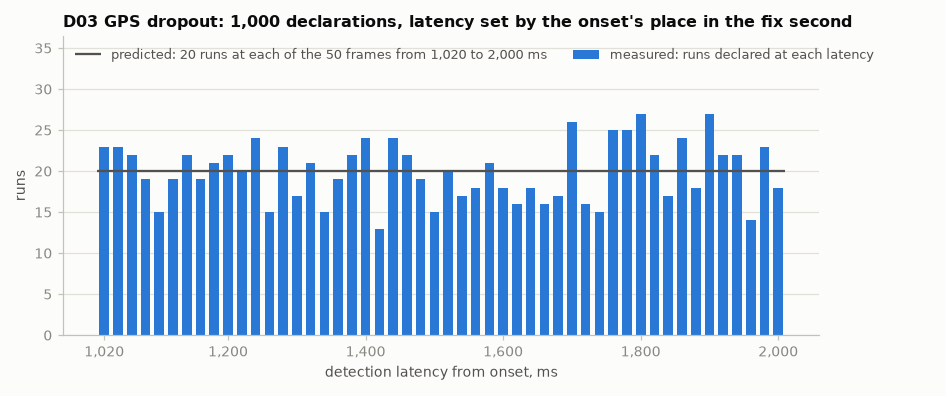
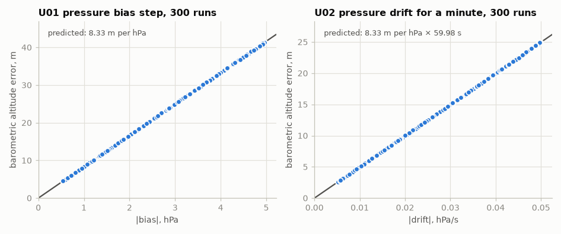
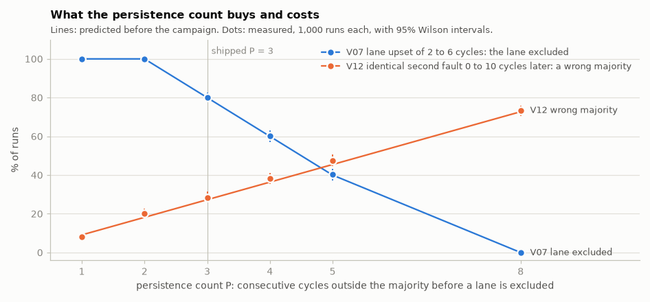

# Flight Telemetry System — Fault-Injection Campaign Report

> **Document ID:** FTS-FI-001
> **Version:** 0.4.0
> **Status:** Campaign of record of 2026-10-21, at `73d1b27`, the commit that holds the measured constants (Section 2). Sections 1, 4 and 5, the method and the predictions, were written and committed on 2026-10-18 before the campaign's code existed, and no prediction has been edited since; Section 5.6, the non-finite check's, was added and committed on 2026-10-19 before that check's code. Section 2, the status, was rewritten for the record. Sections 3 and 6 and the table closing Section 7 are generated from the record; the findings of Section 7 and the measured consequences in Section 8 were written after it, each beside the preview's number of 2026-10-19 where its number moved.
> **Last Updated:** 2026-10-21
> **Related:** FTS-SRD-001 (REQ-TEST-005, REQ-TEST-006, REQ-RED-007), FTS-FM-001 (the failure modes injected), FTS-DD-001 (Section 14, the campaign's design; Section 13, the voter), FTS-TP-001 (TC-035 to TC-037), FTS-VR-001 (the summary of each campaign of record)

This report measures how the flight telemetry system's fault detector and its three-lane voter behave under tens of thousands of randomized, seeded faults: how fast each check declares the fault it is built for, how often anything is declared on a channel with nothing wrong, how a channel recovers, where no check looks, and what the voter's persistence count buys and costs. Every number in it is measured against a prediction written down before the campaign ran. It is meant to be read on its own: Section 1 defines every term it uses, and nothing else in the repository is needed to follow it.

---

## 1. The system and its terms

The system produces one record, a *frame*, every 20 ms. Each frame carries the raw readings of three *channels*: a barometer (pressure and temperature), an inertial measurement unit or IMU (three accelerations and three rotation rates), and a GPS receiver, which delivers a fresh fix once a second and repeats the last one between fixes, marked not fresh. Each frame also carries five computed values, the barometric altitude, the pitch, the roll, the fused altitude and the vertical speed, each with a *validity*: NORMAL (a current estimate), FAILURE_WARNING (held or coasting, not to be trusted) or NO_COMPUTED_DATA (never existed).

```
 simulated     ──►  fault      ──►  fault detector  ──►  lane 1 ─┐
 sensors            injector         timeout, stuck,     lane 2 ─┼─►  voter  ──►  the frame
 (baro, IMU,        (sensor          range; each         lane 3 ─┘                emitted
  GPS at 1 Hz)       faults)         channel's status       ▲
                                                lane-fault injector (lane faults)
```

The *fault detector* judges each channel on every frame and gives it a status: NOMINAL, or DEGRADED once it *declares* a fault. It has three checks:

- a **communication timeout**: no successful reading for more than 500 ms on the barometer or the IMU, or 2,000 ms on the GPS;
- a **stuck reading**: ten identical readings in a row of the barometer's pressure or of any one IMU axis;
- a **range check**: a pressure outside 300 to 1,100 hPa, a temperature outside −40 to 85 °C, or an acceleration at either rail of the sensor's ±2 g scale.

A DEGRADED channel *recovers* to NOMINAL after five consecutive valid readings. Every declaration and every recovery is logged as an *event*.

The processing runs in three identical *lanes*, each with its own filters, all given the same checked frame. A *voter* compares their outputs bit for bit, emits the majority's, and sets bits in the frame's voter status: VOTED on every frame it produced, a lane's bit once that lane is excluded, NO_MAJORITY when no two lanes agree. A lane outside the majority on P consecutive cycles is excluded until restart; P is the *persistence count*, 3 in the shipped system. With no majority the voter holds its last voted values under FAILURE_WARNING.

**The terms of this report.**

- **Onset** and **removal**: the frames on which a fault is switched on and off, the operator's clock (when the cable is pulled). For the GPS, whose dropout changes nothing until the next fix is due, the *first suppressed fix* is also given.
- **Detection latency**: the time from onset to the first declaration on the faulted channel.
- **Missed detection**: no declaration on the faulted channel while the fault is on.
- **False alarm**: a declaration on a channel with nothing injected, counted on clean runs and on the untouched channels of every injected run.
- **Wrong-channel declaration**: a declaration on another channel while the fault is on.
- **Recovery time**: from removal to the channel's return to NOMINAL.
- **Isolation latency**: from a lane fault's onset to the lane's exclusion.
- **Healthy lane thrown out**: an excluded lane that was never altered.
- **No-majority episode**: one stretch of frames with no majority, from its first frame to the next frame that has one.
- **Wrong output**: a frame the voter marked VOTED, with a majority, whose computed values are not a healthy lane's.

---

## 2. Status

This is the **campaign of record**, run on 2026-10-21 on a clean tree at `73d1b27`, with the configuration of record: the Kalman filter's barometric variance and initial velocity variance, and the simulator's four sensor sigmas, measured on the stationary capture of 2026-10-21 (FTS-NP-001). It replaces the preview of 2026-10-19, run at the placeholder constants and the simulator's former, pessimistic noise. The noise model is still the simulator's: Gaussian noise on continuous floating-point readings, now of the measured standard deviations, never quantized, never a failed read; Section 9 says what that leaves out. Where a number moved from the preview, Section 7 gives both.

---

## 3. What was run

<!-- generated:run -->
- **Commit:** `73d1b274a939729a5222cf735789f5a6a9827b2c`
- **Platform:** macOS 27.2 (Darwin 27.2.0, arm64), Apple M1 Max
- **Toolchain:** compiler Apple LLVM 21.0.0 (clang-2100.3.34.2); libc++ 220106; not optimized
- **Configuration:** `config/telemetry_config.yaml`, SHA-256 `c8e53b15f0305242ffbc83cc9f54a5c4deed79305d601a49c1672abb79a955ce`
- **Timing:** 20 ms frames; timeouts of 500 ms (barometer and IMU) and 2,000 ms (GPS); a GPS fix every 1,000 ms; a stuck count of 10 and a recovery count of 5
- **Runs:** 97,100 in 93 cells, 151 s on one core; 0 invalid
- **As predicted, run by run (the gate):** 97,100 of 97,100
- **As Section 5 was written:** 96,423 of 97,100 (Section 7)

A run's id is its seed, `cell × 100,000 + replicate` (Section 4.3); `build/fault_campaign --seed <id>` rebuilds any run.

| Kind | Cells | Runs per cell | Run ids |
|---|---|---|---|
| D01 barometer dropout | 0 | 1,000 | 0–999 |
| D02 IMU dropout | 1 | 1,000 | 100,000–100,999 |
| D03 GPS dropout | 2 | 1,000 | 200,000–200,999 |
| D04 I2C bus failure | 3 | 1,000 | 300,000–300,999 |
| D05 barometer stuck | 4 | 1,000 | 400,000–400,999 |
| D06 accelerometer axis stuck | 5 | 1,000 | 500,000–500,999 |
| D07 gyroscope axis stuck | 6 | 1,000 | 600,000–600,999 |
| D08 pressure out of range | 7 | 1,000 | 700,000–700,999 |
| D09 temperature out of range | 8 | 1,000 | 800,000–800,999 |
| D10 accelerometer at a rail | 9 | 1,000 | 900,000–900,999 |
| T01 I2C dropout below the timeout | 10 | 1,000 | 1,000,000–1,000,999 |
| T02 GPS dropout of at most one fix | 11 | 1,000 | 1,100,000–1,100,999 |
| T03 hold below the stuck count | 12 | 1,000 | 1,200,000–1,200,999 |
| U01 pressure bias step | 13 | 300 | 1,300,000–1,300,299 |
| U02 pressure drift | 14 | 300 | 1,400,000–1,400,299 |
| U03 accelerometer bias | 15 | 300 | 1,500,000–1,500,299 |
| U04 GPS altitude bias | 16 | 300 | 1,600,000–1,600,299 |
| U05 GPS fix frozen | 17 | 300 | 1,700,000–1,700,299 |
| U06 NaN pressure | 18 | 300 | 1,800,000–1,800,299 |
| U07 infinite x rotation rate | 19 | 300 | 1,900,000–1,900,299 |
| C00 clean | 20 | 10,000 | 2,000,000–2,009,999 |
| V01 lane value, persistent | 21–26 (P = 1, 2, 3, 4, 5, 8) | 1,000 | 2,100,000–2,100,999 to 2,600,000–2,600,999 |
| V02 lane NaN, persistent | 27–32 (P = 1, 2, 3, 4, 5, 8) | 1,000 | 2,700,000–2,700,999 to 3,200,000–3,200,999 |
| V03 lane overrun, persistent | 33–38 (P = 1, 2, 3, 4, 5, 8) | 1,000 | 3,300,000–3,300,999 to 3,800,000–3,800,999 |
| V04 lane value, one cycle | 39–44 (P = 1, 2, 3, 4, 5, 8) | 1,000 | 3,900,000–3,900,999 to 4,400,000–4,400,999 |
| V05 lane NaN, one cycle | 45–50 (P = 1, 2, 3, 4, 5, 8) | 1,000 | 4,500,000–4,500,999 to 5,000,000–5,000,999 |
| V06 lane overrun, one cycle | 51–56 (P = 1, 2, 3, 4, 5, 8) | 1,000 | 5,100,000–5,100,999 to 5,600,000–5,600,999 |
| V07 lane value, L cycles | 57–62 (P = 1, 2, 3, 4, 5, 8) | 1,000 | 5,700,000–5,700,999 to 6,200,000–6,200,999 |
| V08 lane input upset | 63–68 (P = 1, 2, 3, 4, 5, 8) | 1,000 | 6,300,000–6,300,999 to 6,800,000–6,800,999 |
| V09 two lanes, identical flip | 69–74 (P = 1, 2, 3, 4, 5, 8) | 1,000 | 6,900,000–6,900,999 to 7,400,000–7,400,999 |
| V10 two lanes, identical NaN | 75–80 (P = 1, 2, 3, 4, 5, 8) | 1,000 | 7,500,000–7,500,999 to 8,000,000–8,000,999 |
| V11 two lanes, different flips | 81–86 (P = 1, 2, 3, 4, 5, 8) | 1,000 | 8,100,000–8,100,999 to 8,600,000–8,600,999 |
| V12 two lanes, identical flip, delayed | 87–92 (P = 1, 2, 3, 4, 5, 8) | 1,000 | 8,700,000–8,700,999 to 9,200,000–9,200,999 |
<!-- end generated -->

---

## 4. Method

### 4.1 A run

Each run builds the system's own objects in one process: the simulator, behind a fault injector, then the detector, then the three lanes and the voter at the cell's persistence count. It steps them frame by frame, unpaced, with the configuration of record. Every channel is NOMINAL from the first frame, and the filters are born on it. A fault's onset is drawn uniformly over the frames of [2 s, 12 s) for a sensor fault, ten whole GPS periods so that the onset's place in the fix second is uniform, and of [2 s, 4 s) for a lane fault. Its duration is drawn from the cell's range. A sensor fault's run ends 1 s after removal, or 6 s for the GPS, so that a recovery has time to show. Each run checks at onset that every channel is NOMINAL and every validity NORMAL; a run that fails the check is counted invalid and none is expected.

Each frame's channel statuses, voter bits, voted values and validities are recorded with every event, beside a reference. For a lane fault the reference is an unaltered lane's own output. For a fault no check covers, it is the voted output of the run's *twin*: the same seed with nothing injected. The injectors draw no random number, so the twin is the run's exact counterfactual.

### 4.2 The cells

A cell is one fault kind at one persistence count. Sensor and clean cells run at the shipped count, 3. Each lane kind runs at P = 1, 2, 3, 4, 5 and 8. The failure-mode numbers are FTS-FM-001's.

| Cell | Failure mode | Injection | Ranges (uniform) |
|---|---|---|---|
| D01 | FAULT-001 barometer timeout | every read fails, fields held | 1.0–5.0 s |
| D02 | FAULT-002 IMU timeout | every read fails | 1.0–5.0 s |
| D03 | FAULT-003 GPS timeout | every fix fails | 3.0–8.0 s |
| D04 | FAULT-004 bus failure | barometer and IMU fail together | 1.0–5.0 s |
| D05 | FAULT-005 barometer stuck | pressure and temperature repeat the last good reading | 0.5–5.0 s |
| D06 | FAULT-006 accelerometer stuck | one axis, x, y or z, repeats its value from the frame before | 0.5–5.0 s |
| D07 | FAULT-007 gyroscope stuck | one axis, x, y or z, the same | 0.5–5.0 s |
| D08 | FAULT-008 pressure out of range | pressure replaced by a constant | 100–299 or 1,101–1,500 hPa, 0.5–5.0 s |
| D09 | FAULT-009 temperature out of range | temperature replaced by a constant | −80 to −41 or 86 to 150 °C, 0.5–5.0 s |
| D10 | FAULT-010 accelerometer saturated | one axis at exactly one rail, +19.6194 or −19.62 m/s² | 0.5–5.0 s |
| T01 | below FAULT-001/002's timeout | a barometer or IMU dropout | 1–25 frames |
| T02 | below FAULT-003's timeout | a GPS dropout | 1–50 frames |
| T03 | below FAULT-005/006/007's count | a barometer or one IMU axis held | 1–8 frames |
| U01 | FAULT-023 bias step | pressure offset | ±0.5–5.0 hPa, to the end |
| U02 | FAULT-023 drift | pressure offset growing at a rate | ±0.005–0.05 hPa/s for 60 s |
| U03 | FAULT-023 bias step | acceleration offset on x or y | ±0.05–0.5 m/s², to the end |
| U04 | FAULT-023 bias step | GPS altitude offset | ±5–50 m, to the end |
| U05 | FAULT-023 frozen fix | the GPS reading held, still marked fresh at 1 Hz | 30 s |
| U06 | FAULT-024 NaN | pressure NaN | one frame |
| U07 | FAULT-024 infinity | x rotation rate +∞ | one frame |
| C00 | none | nothing | 60 s runs |
| V01 | FAULT-020 persistent value | one lane's output: one bit of one computed value flipped, every cycle | lane, value and bit (0–31) |
| V02 | FAULT-020 persistent NaN | that value NaN, every cycle | lane, value |
| V03 | FAULT-022 persistent overrun | the lane's previous cycle's output handed to the voter | lane |
| V04 | FAULT-019 transient value | V01 for one cycle | as V01 |
| V05 | FAULT-019 transient NaN | V02 for one cycle | as V02 |
| V06 | FAULT-022 transient overrun | V03 for one cycle | as V03 |
| V07 | FAULT-019/020 upset of L cycles | V01 for L cycles | L 2–6 |
| V08 | FAULT-020 state upset | one bit of one raw input a lane's filters read, one cycle | lane; pressure, accel x or y, gyro x or y; bit |
| V09 | FAULT-021 common mode | two lanes, the identical flip, every cycle | two lanes, value, bit |
| V10 | FAULT-021 common NaN | two lanes, the identical NaN | two lanes, value |
| V11 | FAULT-021 two different faults | lane a flipped; lane b flipped differently from g cycles later | g 0–10 |
| V12 | FAULT-021 two identical, delayed | lane b with lane a's flip from g cycles later | g 0–10 |

### 4.3 Seeds and reproducibility

A run's seed is its id, `cell × 100,000 + replicate`, and the id alone reproduces the run. The schedule (onset, duration, magnitude, lane, value, bit, gap) and the simulator's seed are derived from the kind and the replicate, not from the persistence count. The six counts of one lane kind therefore run over the same faults and the same noise, and their differences are the count's alone.

The schedule is drawn by the harness's own arithmetic over `std::mt19937` seeded by `std::seed_seq`, both fixed by the C++ standard, so a seed gives the same schedule on every platform. The simulator's noise comes from the standard library's normal distribution, whose algorithm is not fixed, so the measured distributions belong to the platform Section 3 names.

### 4.4 Outcomes

Every declaration falls in exactly one bucket.

- **On the faulted channel:**
  - *the detection*: inside the window, which runs from onset to the channel's first fresh reading after removal (for the GPS a timeout can fall on or just after the removal frame; that is a late detection, not a false alarm);
  - *a repeat*: a later one inside the window;
  - *a false alarm*: one before onset or after the channel recovered.
- **On another channel:**
  - *a wrong-channel declaration* while the fault or its recovery window lasts;
  - *a false alarm* otherwise.
- **The recovery time** comes from the recovery event after removal.

For the voter:
- the isolation latency;
- healthy lanes thrown out;
- wrong outputs;
- no-majority episodes, whose events are checked against the rising edges of the NO_MAJORITY bit.

Four invariants are checked on every frame: at least two lanes in the vote, at most one lane bit, VOTED set, and no NaN in a voted value.

### 4.5 Statistics

- **Rates.** A rate is k of n runs, stated with its 95% Wilson interval. It stays inside [0, 1] and is honest at k = 0 and k = n, where the textbook normal interval collapses to a point.
- **Zero counts.** A count of zero also carries the rule-of-three bound, 3/n: the rate below which zero events in n runs would happen at least 5% of the time. The exact value, 1 − 0.05^(1/n), is printed beside it.
- **False alarms** are counted against their exposure: the channel-hours on which nothing was injected. Exposure is counted once per kind and replicate, because the six persistence counts of a lane kind show the detector the same frames.
- **Latencies** are distributions, reported as their median, 95th percentile and maximum by the nearest-rank rule, so every reported value is one the campaign observed, on the 20 ms grid.

### 4.6 Run counts, chosen from the bounds

| Class | Runs per cell | What it buys at 95% |
|---|---|---|
| D01–D10, T01–T03 | 1,000 | a miss or false-declaration rate below 0.30% if none is seen; a 95th percentile from 1,000 values |
| U01–U07 | 300, each with its twin | a detection rate below 1.0% if none is seen; the consequence's median, 95th percentile and maximum |
| C00 | 10,000 runs of 60 s | a false-alarm rate below 0.03% per run, and below 0.018 per channel-hour from these runs alone |
| V01–V12, at each count | 1,000 | each rate within about ±3 points; a per-run rule checked on every run |

A fixed subset, ten seeds per cell and the lane cells at P = 1 and 3, runs on every build of the code and fails it on any departure from a per-run prediction (FTS-TP-001 TC-035).

---

## 5. Predictions

Written and committed on 2026-10-18, before the campaign's code existed, from the shipped configuration:
- 20 ms frames;
- timeouts of 500 ms (I2C) and 2,000 ms (GPS);
- a stuck count of 10 and a recovery count of 5;
- the limits of Section 1;
- one GPS fix a second.

Each is also a formula of the configuration in the campaign's catalogue, and a test holds the formulas to these numbers. Where a prediction depends on the simulator's own values (a reading before onset that repeated its predecessor; a removal frame whose live value equals a held one), each run's prediction is computed from the frames it generated, so the coincidence is predicted rather than tolerated. No prediction will be edited after the campaign runs: a gap is a finding (Section 7).

### 5.1 Faults the detector is built for

| Cell | Predicted detection | Predicted recovery |
|---|---|---|
| D01, D02 | **exactly 500 ms**: the 26th failed frame, the event's value 520 ms (the time since the last good reading). A dropout of 25 frames or fewer is never declared. | **80 ms** after removal: the fifth valid frame |
| D03 | the last delivered fix + 2,020 ms, so on the operator's clock **uniform over 1,020 to 2,000 ms** in 20 ms steps: nearest-rank median 1,500, 95th percentile 1,960, maximum 2,000. From the first suppressed fix, **always 1,020 ms**. The event's value always 2,020. | **4,000 to 4,980 ms** after removal: the fifth fix at or after it; always 4,000 ms from the first fix after removal |
| D04 | two declarations on one frame, barometer then IMU, both at 500 ms | 80 ms each |
| D05 | **160 ms**: the ninth held frame, the last good reading counted as the first of ten. 140 ms when the reading before onset happened to repeat its predecessor (a float step of 6.1e-5 hPa against noise of 0.2 hPa: about 1 run in 12,000). | 80 ms; 100 ms when the removal frame's live value equals the held one (about 1 run in 12,000) |
| D06, D07 | 160 ms, on the held axis; the z rotation rate, which the attitude filter ignores, is checked like the others | 80 ms |
| D08, D09, D10 | **0 ms**: on the onset frame, the event's value the injected one | 80 ms |

No D cell raises a voter event: every lane sees the same frame.

### 5.2 Faults below the thresholds

| Cell | Prediction |
|---|---|
| T01 | no declaration: the time since the last good reading reaches at most 500 ms, and the rule is "more than" |
| T02 | no declaration: at most one fix is lost, so the time since the last fix peaks at 1,980 ms |
| T03 | no declaration, except for an 8-frame hold whose reading before onset repeated its predecessor (about 1 run in 100,000) |

### 5.3 Faults no check covers

| Cell | Prediction |
|---|---|
| U01 | **no event.** The barometric altitude shifts by about 8.3 m per hPa of bias (the standard atmosphere's slope at 1,013 hPa) with validity NORMAL; the fused altitude follows nearly all of it, the GPS carrying about 0.2% of the weight. |
| U02 | **no event.** The altitude error grows to 2.5–25 m over the minute, and a false vertical speed of about 8.3 m/s per hPa/s of drift shows as NORMAL. The pressure stays more than 80 hPa inside its limits. |
| U03 | **no event.** The pitch or roll is off by atan(offset / g), 0.3° to 2.9°, reached within a few seconds (the attitude filter's time constant is about 1 s). |
| U04 | **no event.** Under 1% of the offset reaches the fused altitude (about 0.24%). |
| U05 | **no event**: the GPS has no stuck check. The position freezes; the fused altitude barely moves. |
| U06 | **no detector event.** The NaN passes every check (every comparison with NaN is false), enters the Kalman filter's state and never leaves it. No majority **from that frame to the end of the run**: one NO_MAJORITY event, value 3 (the lanes in the vote), every computed value held under FAILURE_WARNING, no NaN in the output. |
| U07 | **no event.** The roll becomes +∞ in all three lanes and stays so; the lanes agree, because the voter refuses NaN only, and the frame leaves **VOTED with the roll NORMAL**. |

### 5.4 Clean runs

C00 and the untouched channels of every injected run: **zero declarations.** This is all but certain by construction: the chance of a Gaussian float repeating itself ten times, or straying 87 hPa from its mean, is far below 1e-30 a frame (Section 9). There is no voter event, and every frame is VOTED; that part is certain, since identical lanes on identical input agree.

### 5.5 Lane faults, at persistence count P

| Cell | Prediction |
|---|---|
| V01, V02 | the onset event on the onset frame; the lane excluded **(P − 1) × 20 ms** after onset (40 ms at P = 3), its bit set from the next frame; the voted output a healthy lane's on every frame; no NO_MAJORITY |
| V03 | the onset event names an overrun; then as V01 |
| V04, V05, V06 | one onset event; the lane excluded **only at P = 1**, on the onset frame, which throws out a lane whose state was intact; the output a healthy lane's throughout |
| V07 | excluded if and only if L ≥ P: every run at P = 1 and 2; 80%, 60% and 40% at P = 3, 4 and 5; none at P = 8 |
| V08 | the lane's filters carry the upset for seconds, so the lane is excluded (P − 1) × 20 ms after onset at every P, unless the arithmetic rounds the flip away; that fraction is measured, not predicted. Excluded exactly when the lane disagrees with a healthy lane on P consecutive cycles, which the campaign checks run by run. |
| V09 | the two wrong lanes are the majority: **the healthy lane is thrown out** (P − 1) × 20 ms after onset, and **the wrong value is voted** on every frame from onset |
| V10 | no majority from onset to the end, one event (value 3), no exclusion |
| V11 | **no majority from the second fault to the end, at every P**: if g ≥ P, lane a excluded first and the event's value 2; if g < P, value 3 and lane a never excluded; the held output the same either way |
| V12 | if g ≥ P, lane a excluded first and then no majority, value 2: safe. If g < P, **a wrong majority**: the healthy lane excluded 20 × (g + P − 1) ms after the first fault, the wrong value voted. That happens in P out of 11 runs, **more often as P grows**. |

On every frame, at least two lanes stay in the vote, at most one lane bit is set, and no voted value is NaN.

### 5.6 The non-finite check (FAULT-024)

Written and committed on 2026-10-19, before the check's code. REQ-FAULT-003, amended that day, declares a reading of the barometer or the IMU, or a GPS fix's position, altitude, ground speed or course, that is not a finite number OUT_OF_RANGE on its channel, ahead of the range and stuck tests. Section 5.3's rows for U06 and U07 stand as written: they predicted the system before the check. From the check on, every U06 and U07 run departs from them by design (`as_written`), and the gate holds those runs to the following.

| Cell | Predicted since the check |
|---|---|
| U06 | OUT_OF_RANGE on the barometer on the onset frame (**0 ms**), the event's value NaN; recovered **80 ms** after removal, on the fifth valid frame; no voter event and no frame without a majority. The barometric altitude is FAILURE_WARNING for the five frames the barometer is DEGRADED, then NORMAL. The fused altitude and vertical speed stay NORMAL throughout, the GPS still contributing (REQ-PROC-007), and so do pitch and roll, so **no frame holds every field under FAILURE_WARNING**. Every field is NORMAL at the end of the run, and no value voted is not finite. |
| U07 | OUT_OF_RANGE on the IMU on the onset frame (**0 ms**), the event's value +∞; recovered **80 ms** after removal; no voter event. Pitch and roll are FAILURE_WARNING for the five frames the IMU is DEGRADED, held finite, then NORMAL; **the roll is never infinite**, so never voted NORMAL as one. Every field is NORMAL at the end, and no value voted is not finite. |

Five frames without a barometric (U06) or IMU (U07) measurement leave the fused altitude or the attitude a little off the twin's after recovery; how far is measured, not predicted.

---

## 6. Results

### 6.1 Faults the detector is built for

<!-- generated:detector -->
| Cell | Runs | Missed | Latency, ms | Predicted | Latencies seen (runs) | Recovery, ms | Predicted | As predicted |
|---|---|---|---|---|---|---|---|---|
| D01 barometer dropout | 1,000 | 0 (< 0.3%) | 500 / 500 / 500 | 500 | 500 (1,000) | 80 / 80 / 80 | 80 | 1,000 |
| D02 IMU dropout | 1,000 | 0 (< 0.3%) | 500 / 500 / 500 | 500 | 500 (1,000) | 80 / 80 / 80 | 80 | 1,000 |
| D03 GPS dropout | 1,000 | 0 (< 0.3%) | 1,520 / 1,960 / 2,000 | 1,500 / 1,960 / 2,000, uniform | 50 values, 1,020 to 2,000 | 4,480 / 4,940 / 4,980 | 4,000 to 4,980 | 1,000 |
| D03 on the fix clock |  |  | 1,020 / 1,020 / 1,020 | 1,020 | 1,020 (1,000) | 4,000 / 4,000 / 4,000 | 4,000 |  |
| D04 I2C bus failure, barometer | 1,000 | 0 (< 0.3%) | 500 / 500 / 500 | 500 | 500 (1,000) | 80 / 80 / 80 | 80 | 1,000 |
| D04 I2C bus failure, IMU | 1,000 | 0 (< 0.3%) | 500 / 500 / 500 | 500 | 500 (1,000) | 80 / 80 / 80 | 80 | 1,000 |
| D05 barometer stuck | 1,000 | 0 (< 0.3%) | 160 / 160 / 160 | 160; 140 after a repeat | 160 (1,000) | 80 / 80 / 100 | 80; 100 after a repeat | 1,000 |
| D06 accelerometer axis stuck | 1,000 | 0 (< 0.3%) | 160 / 160 / 160 | 160; 140 after a repeat | 160 (1,000) | 80 / 80 / 80 | 80; 100 after a repeat | 1,000 |
| D07 gyroscope axis stuck | 1,000 | 0 (< 0.3%) | 160 / 160 / 160 | 160; 140 after a repeat | 160 (1,000) | 80 / 80 / 80 | 80; 100 after a repeat | 1,000 |
| D08 pressure out of range | 1,000 | 0 (< 0.3%) | 0 / 0 / 0 | 0 | 0 (1,000) | 80 / 80 / 80 | 80 | 1,000 |
| D09 temperature out of range | 1,000 | 0 (< 0.3%) | 0 / 0 / 0 | 0 | 0 (1,000) | 80 / 80 / 80 | 80 | 1,000 |
| D10 accelerometer at a rail | 1,000 | 0 (< 0.3%) | 0 / 0 / 0 | 0 | 0 (1,000) | 80 / 80 / 80 | 80 | 1,000 |

Latencies run from onset and recoveries from removal, each as median / 95th percentile / maximum by the nearest rank. On the fix clock, D03's latency runs from the first fix the dropout suppressed and its recovery from the first fix after removal. *Missed* is no declaration while the fault was on; a zero carries its rule-of-three bound. A run is *as predicted* when every per-run prediction held: the declaration's type, latency and value, the recovery, no repeat, no false alarm, no declaration on another channel and no voter event. A count of zero in n runs bounds the rate below 3/n, the rule of three (0.3% against 0.299% exactly at 1,000 runs).

Over these 10,000 runs: 0 declarations on another channel, 0 repeats, 0 false alarms and 0 voter events.


<!-- end generated -->

### 6.2 Faults below the thresholds

<!-- generated:transients -->
| Cell | Runs | Runs with a declaration | Predicted | As predicted |
|---|---|---|---|---|
| T01 I2C dropout below the timeout | 1,000 | 0 (< 0.3%) | none | 1,000 |
| T02 GPS dropout of at most one fix | 1,000 | 0 (< 0.3%) | none | 1,000 |
| T03 hold below the stuck count | 1,000 | 1 (0.1%; 0.0177%–0.564%) | none, but a hold whose run with the readings around it reaches the stuck count, predicted run by run from its frames | 1,000 |

A count of zero in n runs bounds the rate below 3/n, the rule of three (0.3% against 0.299% exactly at 1,000 runs).
<!-- end generated -->

### 6.3 Faults no check covers

<!-- generated:uncovered -->
| Cell | Runs | Runs with a declaration | Consequence | Median / 95th percentile / maximum, or runs | Predicted | As predicted |
|---|---|---|---|---|---|---|
| U01 pressure bias step | 300 | 0 (< 1%) | barometric altitude error per hPa of bias, m | 8.33 / 8.34 / 8.34 | about 8.3 (8.33 at 1,013.25 hPa) | 300 |
|  |  |  | fused altitude error, share of the barometric | 120% / 120% / 120% | nearly all; the GPS carries about 0.2% of the weight |  |
|  |  |  | vertical speed error, m/s | 23.3 / 37.4 / 39 | not predicted |  |
|  |  |  | frames after onset with a NORMAL value off the twin's, share | 100% / 100% / 100% | — |  |
| U02 pressure drift | 300 | 0 (< 1%) | barometric altitude error at the end of the minute, m | 14.1 / 24.1 / 24.9 | 2.5 to 25 | 300 |
|  |  |  | that error against 8.33 m/hPa × the drift × the time since onset | 1.000 / 1.001 / 1.001 | 1 |  |
|  |  |  | vertical speed error per hPa/s of drift, m/s | 8.69 / 8.73 / 8.81 | about 8.3 |  |
|  |  |  | frames after onset with a NORMAL value off the twin's, share | 99.97% / 99.97% / 99.97% | — |  |
| U03 accelerometer bias | 300 | 0 (< 1%) | pitch or roll error, degrees | 1.6 / 2.82 / 2.91 | 0.3 to 2.9 | 300 |
|  |  |  | that error against atan(offset / g) | 1.000 / 1.000 / 1.000 | 1 |  |
|  |  |  | frames after onset with a NORMAL value off the twin's, share | 100% / 100% / 100% | — |  |
| U04 GPS altitude bias | 300 | 0 (< 1%) | fused altitude error, share of the bias | 0.0128% / 0.0128% / 0.0128% | under 1%, about 0.24% | 300 |
|  |  |  | frames after onset with a NORMAL value off the twin's, share | 98.4% / 99.9% / 100% | — |  |
| U05 GPS fix frozen | 300 | 0 (< 1%) | fused altitude error, m | 0.000704 / 0.00107 / 0.0013 | negligible | 300 |
|  |  |  | frames after onset with a NORMAL value off the twin's, share | 98.7% / 99.9% / 100% | — |  |
| U06 NaN pressure | 300 | 300 (100%; 98.7%–100%) | declared OUT_OF_RANGE on the barometer on its frame, recovered 80 ms after removal | 300 of 300 runs | none before the check (5.3); every run since (5.6) | 300 |
|  |  |  | no majority from the NaN to the end | 0 of 300 runs | every run before the check (5.3); none since (5.6) |  |
|  |  |  | every field held under FAILURE_WARNING to the end | 0 of 300 runs | every run before the check (5.3); none since (5.6) |  |
|  |  |  | every field NORMAL at the end of the run | 300 of 300 runs | none before the check (5.3); every run since (5.6) |  |
|  |  |  | frames after onset with a NORMAL value off the twin's, share | 100% / 100% / 100% | — |  |
| U07 infinite x rotation rate | 300 | 300 (100%; 98.7%–100%) | declared OUT_OF_RANGE on the IMU on its frame, recovered 80 ms after removal | 300 of 300 runs | none before the check (5.3); every run since (5.6) | 300 |
|  |  |  | roll +∞, NORMAL and VOTED on every frame from onset | 0 of 300 runs | every run before the check (5.3); none since (5.6) |  |
|  |  |  | a value emitted that is not a number | 0 of 300 runs | every run before the check (5.3); none since (5.6) |  |
|  |  |  | every field NORMAL at the end of the run | 300 of 300 runs | every run, before the check (the roll's +∞ NORMAL) and since |  |
|  |  |  | frames after onset with a NORMAL value off the twin's, share | 99% / 99% / 99% | — |  |

Each error is the largest difference, over the frames after onset whose value is NORMAL, between the run's voted output and its twin's: the same seed with nothing injected. A share of frames off the twin is the fraction of the frames after onset on which a value the frame calls NORMAL differs from the twin's.


<!-- end generated -->

### 6.4 False alarms: clean runs and untouched channels

<!-- generated:false-alarms -->
| Channel | Exposure, channel-hours | False alarms | Per channel-hour |
|---|---|---|---|
| barometer | 232.5 | 0 | < 0.013 (rule of three) |
| IMU | 238.1 | 0 | < 0.013 (rule of three) |
| GPS | 237.0 | 0 | < 0.013 (rule of three) |
| all three | 707.5 | 0 | < 0.0042 (rule of three) |

Exposure counts each kind and replicate once (37,100 of the 97,100 runs), because the six persistence counts of a lane kind show the detector the same frames. A channel is exposed for the whole of a run that injects nothing into it and up to the onset of a run that does.

The clean runs (C00), 10,000 of 60 s: runs with a declaration 0 (< 0.03%); runs with a voter event 0 (< 0.03%); runs breaking an invariant, a frame without VOTED among them, 0.

Declarations on another channel than the injected one, over the 15,100 runs that inject a sensor fault: 0.
<!-- end generated -->

### 6.5 Lane faults, at persistence count P

<!-- generated:voter -->
**The altered lane excluded**, % of runs (95% Wilson interval where the share is neither 0 nor 100; a 0 or a 100 bounds the other outcome by the rule of three):

| Kind | P = 1 | P = 2 | P = 3 | P = 4 | P = 5 | P = 8 | Predicted |
|---|---|---|---|---|---|---|---|
| V01 | 100 | 100 | 100 | 100 | 100 | 100 | 100 at every P |
| V02 | 100 | 100 | 100 | 100 | 100 | 100 | 100 at every P |
| V03 | 100 | 100 | 100 | 100 | 100 | 100 | 100 at every P |
| V04 | 100 | 0 | 0 | 0 | 0 | 0 | 100 at P = 1, else 0 |
| V05 | 100 | 0 | 0 | 0 | 0 | 0 | 100 at P = 1, else 0 |
| V06 | 100 | 0 | 0 | 0 | 0 | 0 | 100 at P = 1, else 0 |
| V07 | 100 | 100 | 80.1 (77.5–82.5) | 60.2 (57.1–63.2) | 40.3 (37.3–43.4) | 0 | 100, 100, 80, 60, 40, 0 |
| V08 | 91.7 (89.8–93.3) | 91.1 (89.2–92.7) | 90.8 (88.8–92.4) | 90.7 (88.7–92.3) | 90.4 (88.4–92.1) | 89.1 (87.0–90.9) | 100 but where the arithmetic absorbs the flip: measured, not predicted |

**Isolation latency**, ms from the lane fault's onset to its exclusion, median / 95th percentile / maximum over the runs that excluded the lane:

| Kind | P = 1 | P = 2 | P = 3 | P = 4 | P = 5 | P = 8 |
|---|---|---|---|---|---|---|
| predicted, (P − 1) × 20 | 0 | 20 | 40 | 60 | 80 | 140 |
| V01 | 0 / 0 / 0 | 20 / 20 / 20 | 40 / 40 / 40 | 60 / 60 / 60 | 80 / 80 / 80 | 140 / 140 / 140 |
| V02 | 0 / 0 / 0 | 20 / 20 / 20 | 40 / 40 / 40 | 60 / 60 / 60 | 80 / 80 / 80 | 140 / 140 / 140 |
| V03 | 0 / 0 / 0 | 20 / 20 / 20 | 40 / 40 / 40 | 60 / 60 / 60 | 80 / 80 / 80 | 140 / 140 / 140 |
| V04 | 0 / 0 / 0 | — | — | — | — | — |
| V05 | 0 / 0 / 0 | — | — | — | — | — |
| V06 | 0 / 0 / 0 | — | — | — | — | — |
| V07 | 0 / 0 / 0 | 20 / 20 / 20 | 40 / 40 / 40 | 60 / 60 / 60 | 80 / 80 / 80 | — |
| V08 | 0 / 0 / 40 | 20 / 20 / 80 | 40 / 40 / 120 | 60 / 60 / 220 | 80 / 80 / 240 | 140 / 140 / 460 |

One altered lane: 0 of 48,000 runs voted a value other than a healthy lane's.

**Two lanes altered**, % of runs:

| Kind and outcome | P = 1 | P = 2 | P = 3 | P = 4 | P = 5 | P = 8 | Predicted |
|---|---|---|---|---|---|---|---|
| V09: healthy lane thrown out | 100 | 100 | 100 | 100 | 100 | 100 | 100 at every P |
| V09: a wrong output voted | 100 | 100 | 100 | 100 | 100 | 100 | 100 at every P |
| V09: no majority | 0.9 (0.5–1.7) | 0.9 (0.5–1.7) | 0.9 (0.5–1.7) | 0.9 (0.5–1.7) | 0.9 (0.5–1.7) | 0.9 (0.5–1.7) | 0 |
| V10: no majority | 100 | 100 | 100 | 100 | 100 | 100 | 100 at every P |
| V10: healthy lane thrown out | 0 | 0 | 0 | 0 | 0 | 0 | 0 |
| V11: no majority | 100 | 100 | 100 | 100 | 100 | 100 | 100 at every P |
| V11: lane a excluded first | 92.2 (90.4–93.7) | 84.7 (82.3–86.8) | 73.6 (70.8–76.2) | 64.1 (61.1–67.0) | 55.7 (52.6–58.8) | 28.8 (26.1–31.7) | g ≥ P: 90.9, 81.8, 72.7, 63.6, 54.5, 27.3 |
| V11: healthy lane thrown out | 0 | 0 | 0 | 0 | 0 | 0 | 0 |
| V12: a wrong majority: healthy lane thrown out | 8.1 (6.6–10.0) | 20.0 (17.6–22.6) | 28.5 (25.8–31.4) | 38.2 (35.2–41.3) | 47.6 (44.5–50.7) | 73.3 (70.5–75.9) | g < P: 9.1, 18.2, 27.3, 36.4, 45.5, 72.7 |
| V12: no majority, lane a out first | 91.9 (90.0–93.4) | 80.1 (77.5–82.5) | 71.7 (68.8–74.4) | 62.2 (59.2–65.2) | 53.1 (50.0–56.2) | 27.6 (24.9–30.5) | g ≥ P: 90.9, 81.8, 72.7, 63.6, 54.5, 27.3 |

Invariants over all 72,000 lane-fault runs (two lanes in the vote, one lane bit at most, VOTED on every frame, no NaN voted, an event per no-majority episode): 0 runs broke one.


<!-- end generated -->

---

## 7. Measured against predicted

The gate held on every run: all 97,100 match their per-run predictions, with the refinement for V09 and V12 that finding 1 describes. Against Section 5 exactly as written, 677 runs depart, and the table that closes this section lists them by cell, with their seeds:
- **600 in U06 and U07, by design.** Section 5.3's rows predicted the system before the detector's non-finite check of 2026-10-19; every run matches Section 5.6, which predicted it since (finding 7).
- **77 in V09 and V12**, finding 1's (94 in the preview).

Every other per-run prediction held as written. Where a distribution or a rate in Section 6 differs from a number Section 5 gave, the difference is a finding, listed here with its explanation. The numbers quoted are the campaign of record's, with the preview's beside them where they moved: the measured barometric variance, about 54 times smaller than the placeholder, makes the altitude filter faster and the barometer's weight larger, which moves every consequence that runs through the filter (findings 2 to 4), and leaves the thresholds, and so every detection latency, where they were.

**1. V09 and V12: an identical flip that is NaN for part of its range.** Section 5.5 predicted that two lanes carrying the same flip agree with each other, outvote the healthy lane from onset and exclude it (P − 1) × 20 ms later. Every one of the 77 departing runs flips bit 30, the exponent's highest bit, of the barometric altitude (37 runs) or of the fused altitude (40 runs; the preview's 94 runs, 37 and 57):
- **Below 2 m, a NaN.** For a value whose magnitude lies in [1, 2) the exponent field is 127, and setting bit 30 makes it 255.
- **Above 2 m, a tiny finite number.** There the bit is already set, and the flip clears it.

The simulated vehicle sits about 2 m up, and the noise carries both altitudes across 2 m, so the flipped value alternates between NaN and a finite number:
- **On the NaN frames:** a NaN agrees with nothing (REQ-RED-002), so no pair agrees, no majority exists and no count moves (REQ-RED-003).
- **On the finite frames:** the two altered lanes agree, and the healthy lane counts a miss.

The healthy lane is therefore excluded only after P consecutive majority cycles on which the flipped value is finite. That comes later than (P − 1) × 20 ms, and the run shows no-majority episodes where Section 5 predicted none. 9 of V09's 1,000 replicates depart this way at every count (10 in the preview); 11 replicates drew bit 30 of an altitude. 23 of V12's runs depart, from 9 replicates (34 from 11). The voter did what its rules say:
- a NaN is never voted;
- the frames without a majority hold the last vote under FAILURE_WARNING;
- once the healthy lane is out, the finite frames vote the flipped value as NORMAL. That is Section 8's third blind spot, delayed, not prevented.

*The refinement.* The CI subset found this on 2026-10-18, in V09's replicate 4 (seed 6900004) at both of the subset's counts. Section 5 stays as written. Since that day the gate's oracle for V09 and V12 replays the vote frame by frame from the lanes' recorded agreement, a NaN agreeing with nothing, and checks the voter's events and wrong outputs against it. The record keeps both verdicts for every run: `as_predicted` is the gate's and `as_written` is Section 5's.

**2. U01: the fused altitude overshoots a barometric step by a fifth.** Section 5.3 said the fused altitude "follows nearly all" of the barometric shift. Its largest error measured 120% of the barometric error in every run (120.2%; the preview's 120% to 125%). The altitude filter is linear and its gains do not depend on the measurements, so a run minus its twin is the filter's response to the offset alone. Its equations, iterated at the measured constants with the step as the only measurement, give the same:
- the velocity state integrates the innovation;
- the altitude overshoots by 20.2% about 1.1 s after onset (2.9 s in the preview, the slower filter of the placeholder variance);
- it then settles on the step, the value Section 5 predicted.

The prediction was of the settled value; the campaign measures the largest. Nothing in Section 5 predicted the false vertical speed that comes with it under NORMAL: up to 39 m/s, median 23.3 m/s, the same response's velocity, 0.94 m/s per metre of step (7.8 m/s per hPa), which the equations give too; the preview's slower filter showed 17.5 m/s, 8.57 m/s and 0.35 m/s per metre. The faster filter that sees a climb sooner (FTS-NP-001 Section 8) also passes a barometric step to the vertical speed nearly three times as hard.

**3. U02: the false vertical speed runs 4% above the drift's rate.** It measured 8.69 m/s per hPa/s (median; 8.81 at most), against Section 5.3's "about 8.3" (the preview's 8.68). The filter's velocity overshoots a ramp's slope by 4.3% about 2.1 s after onset and is 0.3% above it at the end of the minute (the preview's filter: 4% at 6 s, still 3% above at the end): the same second-order response as finding 2.

**4. U04: 0.0128% of a GPS bias reaches the fused altitude, not about 0.24%.** It stays under Section 5.3's bound of 1%, and the gap is the configuration's. Section 5.3's 0.24% is the GPS's share of the information at the placeholder barometric variance, 1/25 per second against the barometer's 50/3. At the measured variance the barometer's is 50/0.0551 a second, and the GPS's share falls to 0.0044%, which the filter's equations give as the fused error's average over the last 15 s. The campaign measures the largest error, just after each fix: the GPS update pulls the estimate up, and the barometer's 49 updates before the next fix pull it back. The equations give 0.0128% for that peak, the record's value in every run; the preview measured 0.42% at the placeholder. U05's frozen fix follows the same weight: its largest effect on the fused altitude fell from 0.037 m to 1.3 mm.

**5. V11 at P = 2: an interval that misses its prediction.** "Lane a excluded first" measured 84.7% (82.3–86.8%) against 81.8%. Every V11 run matched its per-run prediction given its gap g, so the share is the draw's: g ≥ 2 came up in 847 of the 1,000 replicates against 818 expected (g = 0 and g = 1 came up 78 and 75 times against 91 each). Section 6.5 compares 21 measured shares with fractional predictions, so about one outside its 95% interval is expected. V12's gaps, drawn independently, show no such excess: 800 replicates with g ≥ 2.

**6. V08: later exclusions, and the absorbed share.** Section 5.5's rule held in every run: excluded exactly when the lane disagreed on P consecutive majority cycles. Its typical latency, (P − 1) × 20 ms, is the median at every count, but some runs are later: 4 at P = 1, 12 at P = 3 and 15 at P = 8, the latest 460 ms (the preview's 5, 17, 23 and 480 ms). In those runs the upset reaches the compared outputs intermittently, and a difference the arithmetic rounds away on one cycle restarts the count. The absorbed share, measured rather than predicted, grows with the count: 8.3% of the runs were never excluded at P = 1, 9.2% at P = 3 and 10.9% at P = 8, about a point above the preview's 7.6%, 8.2% and 9.5% at every count. A longer count gives an upset that decays the time to leave the outputs before the count is reached.

**7. The non-finite check (FAULT-024), measured before and after it (2026-10-19).** The preview's U06 and U07 rows (Section 6.3) show the system before the check. REQ-FAULT-003's non-finite clause, predicted in Section 5.6 before its code, makes the detector declare a reading that is not a finite number OUT_OF_RANGE on its frame. U06 and U07 were rerun, 300 runs each, on the tree of the commit before the check (whose rows equal, column for column, a rerun at `307a69c`, which equals the preview's) and on the check's own tree:

| Measure, runs of 300 | U06 before | U06 after | U07 before | U07 after |
|---|---|---|---|---|
| declared OUT_OF_RANGE on its frame (0 ms) | 0 | 300 | 0 | 300 |
| recovered 80 ms after removal | 0 | 300 | 0 | 300 |
| a voter event | 300 (NO_MAJORITY) | 0 | 0 | 0 |
| no majority from the fault to the end of the run | 300 | 0 | 0 | 0 |
| every field FAILURE_WARNING from the fault to the end | 300 | 0 | 0 | 0 |
| any frame with every field FAILURE_WARNING | 300 | 0 | 0 | 0 |
| every field NORMAL at the end of the run | 0 | 300 | 300 | 300 |
| roll +∞, NORMAL and VOTED on every frame from onset | 0 | 0 | 300 | 0 |
| a value emitted that is not a number | 0 | 0 | 300 | 0 |
| as the gate predicts | 300 | 300 | 300 | 300 |
| as Section 5.3 was written | 300 | 0 | 300 | 0 |
| error against the twin, median / maximum | none (no NORMAL frame) | 0.086 / 0.274 m (fused altitude) | +∞ (roll) | 0.011 / 0.048° (roll) |

- **A NaN pressure no longer holds every field under FAILURE_WARNING to the end of the run.**
  - Before: every run lost the majority on the NaN's frame and held every field for the 500 frames to the end.
  - After: no run loses a majority, no frame holds every field, and every field is NORMAL at the end. Only the barometric altitude reads FAILURE_WARNING, for the five frames the barometer is DEGRADED; the fused altitude stays NORMAL, the GPS still contributing.
- **An infinite rotation rate is no longer voted NORMAL.**
  - Before: every run voted a roll of +∞ with validity NORMAL on every frame from onset. U07's "every field NORMAL at the end" counted 300 before, and that NORMAL was the infinite roll's.
  - After: no run emits a value that is not a number; the attitude holds its angles under FAILURE_WARNING for five frames and then flies on.
- **Every run matches Section 5.6, and departs from Section 5.3 as written, by design.** The five frames without a measurement leave the fused altitude (U06) and the roll (U07) a little off the twin's, at most 0.27 m and 0.048°.
- **The check changed nothing else.** The full campaign on the check's tree equals the preview's record in every column the two share, for every one of the 96,500 runs outside U06 and U07. Its U06 and U07 rows equal the targeted rerun's. No run anywhere in it emits a value that is not a number.
- **In the campaign of record** every U06 and U07 run matches Section 5.6 (Section 6.3): declared on its frame, recovered 80 ms after removal, no voter event, every field NORMAL at the end, no value emitted that is not a number. The errors against the twin after recovery are smaller at the measured noise: 0.031 / 0.098 m on the fused altitude (U06, median / maximum) and 0.0029 / 0.012° on the roll (U07).

**8. The coincidences Sections 5.1 and 5.2 predicted run by run occurred, once each.** D05's recovery of 100 ms, when the removal frame's live pressure equals the held one, came in run 400025; T03's declaration of a hold whose run with the readings around it reaches the stuck count came in run 1200746, an eight-frame barometer hold from 8,100 ms whose reading before onset had repeated its predecessor, so ten equal pressures and STUCK at 8,240 ms. Both were predicted from their frames, so both runs match the gate and Section 5 as written. Section 5's rarities, about 1 run in 12,000 and 1 in 100,000, were reckoned at the former 0.2 hPa; at the measured 0.0282 hPa two consecutive pressures share a float32 value (6.1e-5 hPa apart near 1,013 hPa) with a chance of 6.1e-4, 7.1 times as often. That makes 0.6 recoveries of 100 ms expected in D05's 1,000 runs, and about 0.01 declarations in T03's 18 eight-frame barometer holds: the one seen was a draw of about 1 in 90.

**Not gaps:**
- D03's median latency is 1,520 ms against the predicted distribution's 1,500. The latency follows the onset's place in the fix second; every run's latency equals its own prediction, and 1,520 is this sample's median, one frame from the population's.
- D05 to D07's 140 ms after a repeat, the remaining coincidence Section 5.1 predicted run by run, did not occur.
- The false-alarm count is zero in 707.5 channel-hours, as Section 5.4 said. Its supporting estimate, ten equal floats in a row below 1e-30 a frame, is about 1e-29 for the pressure at the measured noise: still nothing a campaign could see. Section 9 says why the zero bounds the logic and not the sensors.

<!-- generated:departures -->
| Cell | Runs | Departing from Section 5 as written | Departing from the gate | Seeds | The first departure |
|---|---|---|---|---|---|
| U06 | 300 | 300 | 0 | 1800000, 1800001, 1800002, 1800003, 1800004, … | declarations: 1, predicted 0 |
| U07 | 300 | 300 | 0 | 1900000, 1900001, 1900002, 1900003, 1900004, … | declarations: 1, predicted 0 |
| V09/P1 | 1,000 | 9 | 0 | 6900004, 6900277, 6900336, 6900539, 6900680, … | no-majority episodes: 1, predicted 0 |
| V09/P2 | 1,000 | 9 | 0 | 7000004, 7000277, 7000336, 7000539, 7000680, … | excluded at: 3200, predicted 3120 |
| V09/P3 | 1,000 | 9 | 0 | 7100004, 7100277, 7100336, 7100539, 7100680, … | excluded at: 3220, predicted 3140 |
| V09/P4 | 1,000 | 9 | 0 | 7200004, 7200277, 7200336, 7200539, 7200680, … | excluded at: 3240, predicted 3160 |
| V09/P5 | 1,000 | 9 | 0 | 7300004, 7300277, 7300336, 7300539, 7300680, … | excluded at: 3260, predicted 3180 |
| V09/P8 | 1,000 | 9 | 0 | 7400004, 7400277, 7400336, 7400539, 7400680, … | excluded at: 3320, predicted 3240 |
| V12/P2 | 1,000 | 1 | 0 | 8800549 | excluded at: 2980, predicted 2960 |
| V12/P3 | 1,000 | 2 | 0 | 8900549, 8900748 | excluded at: 3040, predicted 2980 |
| V12/P4 | 1,000 | 4 | 0 | 9000194, 9000549, 9000748, 9000912 | no-majority episodes: 33, predicted 0 |
| V12/P5 | 1,000 | 7 | 0 | 9100194, 9100549, 9100598, 9100653, 9100748, … | excluded at: 3720, predicted 3700 |
| V12/P8 | 1,000 | 9 | 0 | 9200194, 9200549, 9200598, 9200653, 9200748, … | excluded at: 3840, predicted 3760 |

Over the campaign: 677 of 97,100 runs depart from Section 5 as written, 0 from the gate's per-run predictions. The seeds rebuild each run.
<!-- end generated -->

---

## 8. Blind spots

What this campaign shows no check catches, and why:

1. **An error inside the limits** (FAULT-023: U01 to U05). Each check compares a channel with fixed limits, with its own previous value, or with the clock; a bias, a drift or a frozen GPS fix that keeps every reading inside its limits passes all three, and its error leaves the system marked NORMAL. Catching it needs a reference, such as the barometric altitude against the GPS altitude. Measured (Section 6.3):
   - every hPa of pressure bias puts 8.33 m on the barometric altitude;
   - the fused altitude overshoots that by a fifth, with a false vertical speed of up to 39 m/s (17.5 m/s at the placeholder constants);
   - a drift of 0.05 hPa/s puts 25 m on the altitude in a minute;
   - an accelerometer bias tilts the attitude by atan(offset / g), up to 2.9°;
   - all of it under NORMAL.
2. **A non-finite reading** (FAULT-024: U06, U07), **closed on 2026-10-19.** The detector's comparisons were all false for NaN, and it had no rotation-rate limit; a NaN that got through took the voted output down for the rest of the run, on the voter's channel rather than the sensor's, and an infinity was voted through as valid. Measured in the preview: every NaN run lost the majority to the end of the run, and every infinite rate was voted with the roll NORMAL (Section 6.3). The campaign's evidence brought the fix: REQ-FAULT-003's non-finite clause, a finiteness test first on every channel. Section 7's finding 7 measures both cells before and after it.
3. **A fault common to two lanes** (V09, V12). The voter trusts a majority. Two lanes wrong in the same way outvote the healthy one and exclude it, and the wrong value leaves marked VOTED. Measured (Section 6.5):
   - V09 threw out the healthy lane in every run;
   - V12 did so in 8.1% of runs at P = 1, rising to 73.3% at P = 8;
   - a common flip that makes the value NaN for part of its range only delays it (Section 7, finding 1).
4. **Any sensor fault, as far as the voter is concerned.** Every lane is given the same checked frame, so a bad reading goes in and three agreeing lanes come out. The voter sees only faults inside a lane.
5. **Faults shorter than a threshold** (T01 to T03), by design: a dropout of up to 500 ms on the barometer or IMU, the loss of one GPS fix, a reading repeated fewer than ten times.

---

## 9. What this campaign does not prove

- **The faults are simulated.** They are injected into the frame, not on the bus, at the register or on a wire. A real dropout's timing is the driver's, and the bench's wire-pull test is that evidence.
- **One processor.** The three lanes share one CPU, one compiler and one math library, so a defect common to every lane is invisible to the voter, and nothing here shows survival of a hardware failure.
- **The noise model.** The simulator's readings are continuous floats with Gaussian noise far inside every limit, never dropped, and repeated only by float32's rounding. Since the campaign of record their standard deviations are the measured sensors' (FTS-NP-001), unquantized, so the false-alarm figures are still zero by construction and bound only the detector's logic. A real register is quantized, and a quiet sensor repeats a count: on the stationary capture the gyroscope repeated a value seven times in a row, three short of the stuck count, and a run of ten comes about once in 240 hours at rest by extrapolation (FTS-NP-001 Section 8). A quantized simulator, or a campaign sourced from the stationary capture's log, would exercise that.
- **One scenario.** The vehicle sits still. A bias or a drift is easier to see on a still vehicle than on one that climbs.
- **One platform.** The figures are this platform's (Section 3). A seed reproduces its schedule everywhere and its noise only on the same standard library.
- **Assumed fault distributions.** The voter's upset lengths and fault gaps are assumptions, so the sweep shows the shape of the persistence trade-off, not its operating point on real hardware.
- **Coverage is not correctness.** A campaign that matches its predictions shows that the implementation follows its rules. It does not show that the rules, the thresholds or the persistence count are right for an aircraft.

---

## 10. How to rerun

```
scripts/fault_campaign.sh                     # the full campaign on a clean tree: build, run, generate this report's blocks
scripts/fault_campaign.sh --preview           # the same on a tree with changes, recording the tree that ran instead of a commit
build/fault_campaign --seed <id> --log <dir>  # any one run, from its seed alone, with its binary log
python -m analysis.fault_campaign <record>    # the blocks and figures again from a campaign's record, without rerunning it
```

The script records the commit, the platform and the configuration's hash, runs every cell at its stated count, and rewrites only the generated blocks of Sections 3, 6 and 7 and the figures, so `git diff` shows which numbers moved. A campaign of record runs on a clean tree; `--preview` is for a run made before its commit exists, and records the tree's hash, which `git rev-parse <commit>^{tree}` matches once the commit is made. The campaign of record, after the bench session, changed the configuration's measured constants and the simulator's noise, and with them the uncovered faults' consequences (Section 7, findings 2 to 4); as this section said it could not, it changed none of the detection latencies, which follow from the thresholds and the frame period alone, and not the false-alarm figure, which the unquantized noise fixes at zero.
